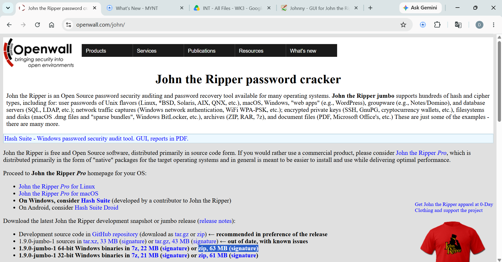
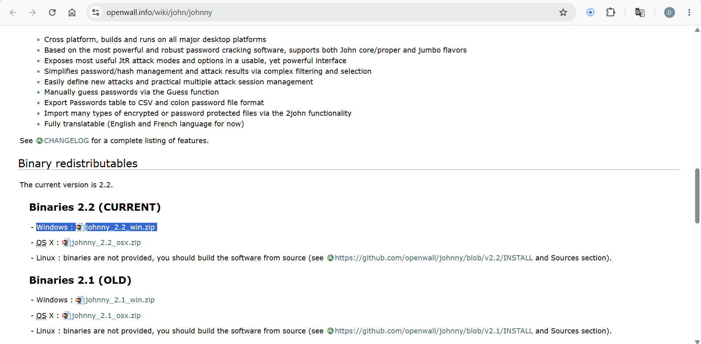
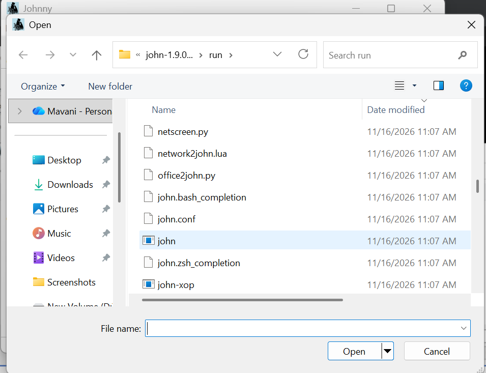
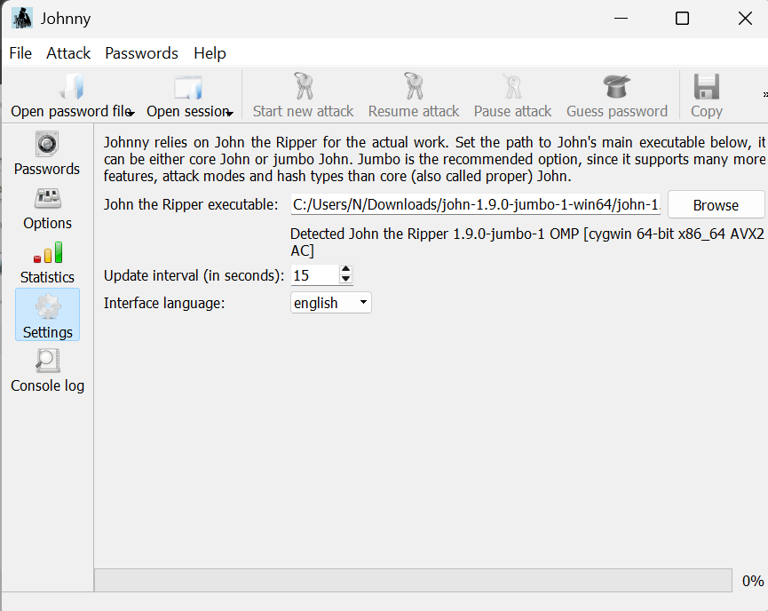
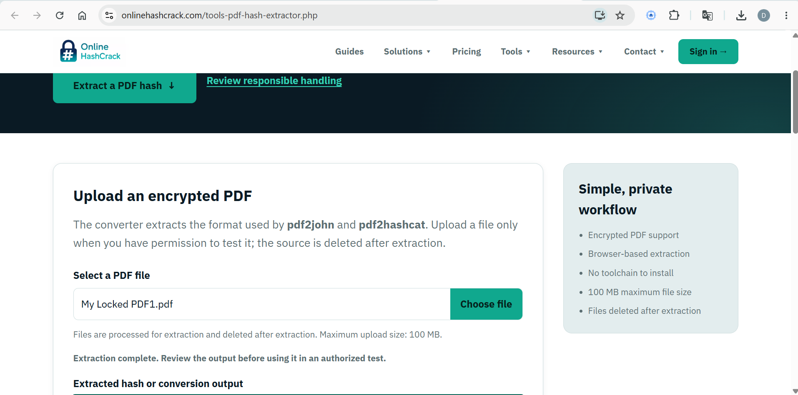
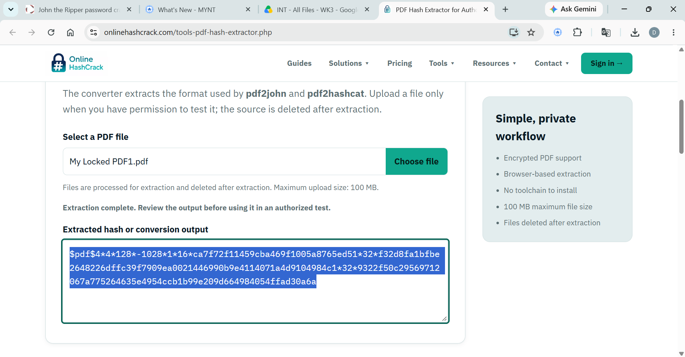
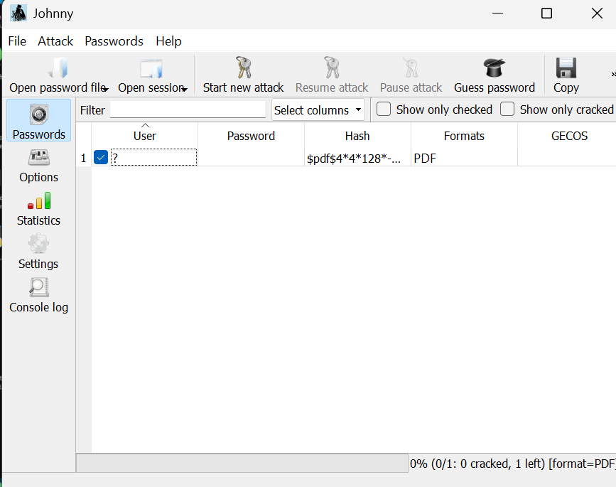
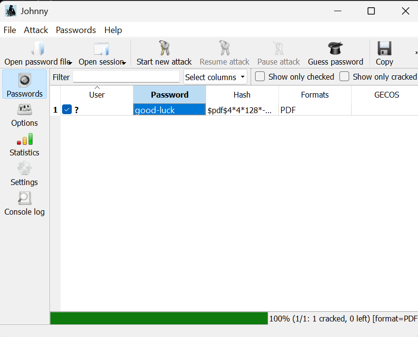
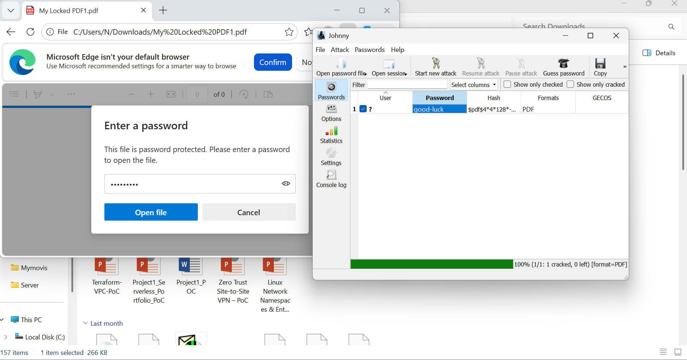

# 🔓 Cracking a Password-Protected PDF with John the Ripper + Johnny (GUI)

A detailed, step-by-step lab walkthrough for recovering the password of a self-created, password-protected PDF using **John the Ripper (jumbo)** 🐏, the **Johnny** GUI front-end 🖥️, and an online **pdf2john**-style hash extractor 🔑.

Done entirely on a file I created myself (`My Locked PDF1.pdf`) purely for learning/practice — **not** against any third-party, client, or production document.

> ⚠️ **Disclaimer:** This project is for **educational and authorized lab use only**. Only run password-recovery tools against files you own or have explicit written permission to test. Unauthorized password cracking is illegal and unethical. 🚫

---

## 🧰 Tools Used

| Tool | Purpose | Link |
|---|---|---|
| 🐏 John the Ripper (jumbo) | Password cracking engine — the actual brute-force/dictionary attack worker | https://www.openwall.com/john/ |
| 🖱️ Johnny | GUI front-end for John the Ripper, so you don't need the command line | https://openwall.info/wiki/john/johnny |
| 🔑 Online PDF Hash Extractor | Converts an encrypted PDF into the `$pdf$...` hash format John/Johnny can actually attack (same format `pdf2john` produces) | https://onlinehashcrack.com/tools-pdf-hash-extractor.php |

## ✅ Prerequisites

- Windows machine (screenshots below are from Windows; Johnny also has macOS builds)
- A password-protected PDF that **you own** 📄🔒
- Basic comfort with downloading/extracting ZIP files

---

## 🪜 Full Step-by-Step Walkthrough

### 1️⃣ Download John the Ripper (jumbo)

Went to the official Openwall site and grabbed the **latest jumbo 64-bit Windows binary** rather than core John, because jumbo supports hundreds of extra hash and cipher types (PDFs, ZIPs, WiFi captures, BitLocker, and more) — core John alone would not have been enough for a PDF hash.

- Opened `openwall.com/john/`
- Scrolled to **"1.9.0-jumbo-1 64-bit Windows binaries"**
- Downloaded the `zip, 63 MB` build and extracted it to a local folder (`john-1.9.0-jumbo-1-win64`)



---

### 2️⃣ Download Johnny (GUI for John the Ripper)

John the Ripper itself is a command-line tool. **Johnny** wraps it in a GUI so hashes, attacks, and results can be managed visually instead of typing commands.

- Opened the Openwall wiki page: `openwall.info/wiki/john/johnny`
- Downloaded **`johnny_2.2_win.zip`** (current version 2.2 at the time)
- Extracted it and launched `Johnny.exe`



---

### 3️⃣ Point Johnny to the John the Ripper executable

On first launch, Johnny doesn't know where John the Ripper is installed, so it needs to be told manually.

- Opened Johnny's **Settings** tab
- Clicked **Browse**
- Navigated to `john-1.9.0-jumbo-1-win64 → run`
- Selected the `john` executable (the core binary Johnny calls under the hood)



---

### 4️⃣ Confirm John the Ripper is detected correctly

This step is easy to skip but important — if Johnny can't correctly detect John, any attack started later will silently fail.

- After selecting the executable, Johnny's Settings tab showed:
  `Detected John the Ripper 1.9.0-jumbo-1 OMP [cygwin 64-bit x86_64 AVX2 AC]`
- ✅ This confirms Johnny is correctly linked to a working jumbo build with OpenMP (multi-threading) support



---

### 5️⃣ Extract the hash from the locked PDF

John/Johnny can't attack a `.pdf` file directly — they need the PDF's internal encryption data converted into a special hash string first (the same thing the classic `pdf2john.py` script does).

- Opened `onlinehashcrack.com/tools-pdf-hash-extractor.php`
- Clicked **Choose file** and selected `My Locked PDF1.pdf`
- Clicked **Extract a PDF hash**



---

### 6️⃣ Copy the extracted hash

- The tool processed the file and returned a hash in the format:
  ```
  $pdf$4*4*128*-1028*1*16*ca7f72f11459cba469f1005a8765ed51*32*f32d8fa1bfbe2648226dffc39f7909ea0021446990b9e4114071a4d9104984c1*32*9322f50c29569712067a775264635e4954ccb1b99e209d664984054ffad30a6a
  ```
- Copied this entire string — this is what gets fed into Johnny next
- 🗑️ Note: the site states uploaded files are deleted after extraction, which is good practice for anything containing sensitive data



---

### 7️⃣ Load the hash into Johnny

- Back in Johnny, went to the **Passwords** tab
- Pasted the hash in (shown under the **Hash** column, format auto-detected as **PDF**)
- Status bar at this point: `0% (0/1: 0 cracked, 1 left)` — nothing cracked yet ⏳



---

### 8️⃣ Start the attack — password cracked! 🎉

- Clicked **Start new attack** in Johnny's toolbar
- Johnny handed the hash to John the Ripper in the background, which ran through its attack (wordlist/dictionary mode)
- Within moments, the **Password** column revealed: **`good-luck`** 🔓
- Status bar updated to: `100% (1/1: 1 cracked, 0 left)` ✅



---

### 9️⃣ Use the cracked password to open the PDF

- Opened `My Locked PDF1.pdf` in the browser/PDF viewer
- When prompted **"Enter a password"**, typed in the recovered password: `good-luck`
- Clicked **Open file**



---

### 🔟 PDF successfully unlocked

- The file opened without any errors, confirming the password `good-luck` was 100% correct
- Page content: a "Congratulations!" graphic — a fitting confirmation that the recovery worked 🥳🎊


---

## 💡 Key Takeaways

- 🔑 A password-protected PDF's encryption metadata can be converted into a crackable hash format (`$pdf$...`) using a `pdf2john`-style tool — John/Johnny can't read the raw PDF directly.
- 🐏 John the Ripper (jumbo) can crack PDF hashes once they're in the right format; Johnny just adds a friendlier UI on top — no commands needed.
- ⚙️ Always verify John the Ripper is correctly detected in Johnny's **Settings** tab (check the "Detected John the Ripper..." message) before starting an attack — otherwise the attack can silently fail.
- 🚫 This technique is strictly for **password recovery on files you own or are authorized to test** — never use it on someone else's documents without permission.

---

## 📁 Repository Structure

```
.
├── README.md
├── 01_download-john-the-ripper.png
├── 02_download-johnny-gui.png
├── 03_johnny-browse-john-executable.png
├── 04_johnny-settings-john-detected.png
├── 05_upload-pdf-to-hash-extractor.png
├── 06_extracted-pdf-hash.png
├── 07_johnny-hash-loaded-0-percent.png
├── 08_password-cracked-100-percent.png
├── 09_enter-cracked-password-in-pdf.png
└── 10_pdf-unlocked-result.png
```
