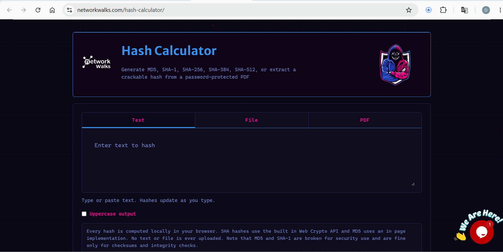
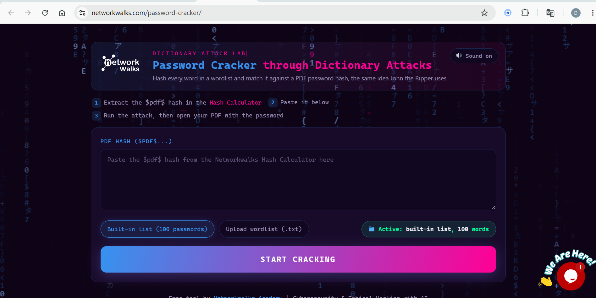

# 🔓 Cracking a Password-Protected PDF — Browser-Based Method (Networkwalks Tools)

A hands-on lab demonstrating how a password-protected PDF can be cracked **entirely in the browser**, with no software installation, using two free tools from **Networkwalks Academy**:

1. **Hash Calculator** — extracts a crackable hash (`$pdf$...`) directly from an encrypted PDF
2. **Password Cracker (Dictionary Attack Lab)** — runs a dictionary attack against that hash to recover the original password

This mirrors exactly what `pdf2john` + `John the Ripper` do locally (see the companion repo: [john-the-ripper-pdf-crack-demo](https://github.com/MavaniDharm/john-the-ripper-pdf-crack-demo)) — except here the entire workflow runs client-side in the browser, with nothing uploaded to a server.

> ⚠️ **Disclaimer:** This lab was performed on a self-created test file (`My Locked PDF2.pdf`) for educational purposes only, as part of the **Networkwalks Cybersecurity Program (Batch B084)**. Only attempt password recovery on files you own or are explicitly authorized to test.

---

## 🧰 Tools Used

| Tool | URL | Purpose |
|---|---|---|
| 🔑 Hash Calculator | https://networkwalks.com/hash-calculator/ | Extracts MD5/SHA hashes, or a crackable `$pdf$...` hash from an encrypted PDF — computed **locally in the browser** |
| 🧨 Password Cracker | https://networkwalks.com/password-cracker/ | Dictionary Attack Lab — hashes every word in a wordlist and matches it against the PDF hash, the same core idea John the Ripper uses |

Both tools are free, browser-based, and process files **locally** — nothing is uploaded to a server, which makes them safe to use for learning without exposing the actual file content.

---

## ✅ Prerequisites

- A password-protected PDF that **you own** (e.g. `My Locked PDF2.pdf`)
- A modern browser (Chrome/Edge/Firefox)
- No installation needed — this entire method runs in-browser

---

## 🪜 Full Step-by-Step Walkthrough

### 1️⃣ Open the Networkwalks Hash Calculator

- Navigated to `networkwalks.com/hash-calculator/`
- The tool supports generating MD5, SHA-1, SHA-256, SHA-384, SHA-512, or extracting a crackable hash from a password-protected PDF
- Three input modes are available: **Text**, **File**, and **PDF**
- Note on the page confirms: *"Every hash is computed locally in your browser... No text or file is ever uploaded."* — important for privacy when testing real files



---

### 2️⃣ Upload the locked PDF and extract its hash

- Switched to the **PDF** tab
- Uploaded `My Locked PDF2.pdf` (204.7 KB)
- The tool detected the file is encrypted and automatically extracted a crackable hash in **pdf2john / hashcat-compatible format**:

  ```
  $pdf$4*4*128*-1028*1*16*0853f2cde0ef15b1c0f93ed229d3b1ad*32*8f13ce5aa39ad974364d36a057da767900
  21446990b9e4114071a4d9104984c1*32*ceecdac74b19b5a62688d3b3524e1374c955cbb9cc3c45316494d9446ef81af1
  ```
- It also reported the PDF's encryption details: **Revision R4, Version V4, Key length 128-bit**
- Used the **Copy** button to grab the hash for the next step



---

### 3️⃣ Open the Password Cracker (Dictionary Attack Lab)

- Navigated to `networkwalks.com/password-cracker/`
- This tool's description sums up the technique perfectly: *"Hash every word in a wordlist and match it against a PDF password hash — the same idea John the Ripper uses."*
- Followed the on-page 3-step guide:
  1. Extract the `$pdf$` hash in the Hash Calculator
  2. Paste it into the input box
  3. Run the attack, then open the PDF with the recovered password
- Pasted the hash copied from Step 2 into the **PDF Hash** field
- Left the wordlist on the default **Built-in list (100 passwords)** option (a custom `.txt` wordlist can also be uploaded)
- Clicked **Start Cracking**


---

### 4️⃣ Password cracked successfully 🎉

- The live log showed each password being tried against the hash in real time:
  ```
  [*] Loaded wordlist: built-in list (100 entries)
  [*] Target: PDF R4 / 128-bit / dictionary attack
  [*] Deriving keys with MD5 + RC4...
  [-] Trying: 123456        ✗
  [-] Trying: password      ✗
  [-] Trying: 123456789     ✗
  ...
  ```
- At **91/100 tried (91%)**, the tool displayed:

  ### ✅ PASSWORD CRACKED SUCCESSFULLY
  ## `password1`

- This confirmed the PDF's password was `password1` — a classic example of a weak, highly guessable password that falls to even a tiny 100-word dictionary


---

### 5️⃣ Verify by unlocking the PDF

- Opened `My Locked PDF2.pdf`
- Entered `password1` when prompted
- File opened successfully, confirming the recovered password was correct ✅

---

## 💡 Key Takeaways

- 🔑 A `$pdf$...` hash can be extracted from any encrypted PDF without needing command-line tools like `pdf2john` — browser-based tools can do the same conversion locally.
- 🧨 A **dictionary attack** simply hashes every candidate password with the same algorithm the PDF uses (here, MD5 + RC4 key derivation) and compares it to the target hash — this is conceptually identical to how John the Ripper works under the hood.
- 🪶 Even a tiny, 100-entry wordlist cracked this password in under 100 tries — a strong reminder of why common/weak passwords (`password1`, `123456`, `qwerty`, etc.) offer almost no real protection.
- 🌐 Because the tool processes everything client-side in the browser, it's a safe, install-free way to practice and demonstrate this concept.
- 🔁 This is the browser-based counterpart to the local John the Ripper + Johnny workflow documented in the companion repo — same underlying concept, two different execution environments.

---

## 🔗 Related Work

- Companion repo (local John the Ripper + Johnny GUI method): **[john-the-ripper-pdf-crack-demo](https://github.com/MavaniDharm/john-the-ripper-pdf-crack-demo)**
- Connect: [linkedin.com/in/dharm-mavani-075525344](https://www.linkedin.com/in/dharm-mavani-075525344)

---

## 📁 Repository Structure

```
.
├── README.md
├── 01_networkwalks-hash-calculator-tool.png
├── 02_pdf-hash-extracted-networkwalks.png
├── 03_networkwalks-password-cracker-tool.png
└── 04_password-cracked-password1-result.png
```
